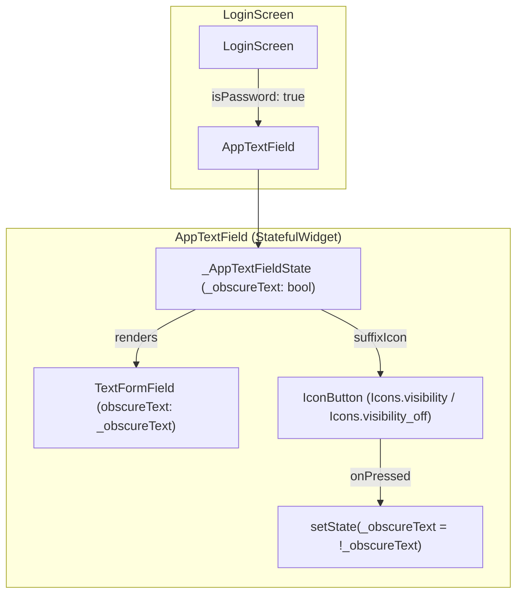

# Toggleable Password Visibility Implementation Plan

> **For agentic workers:** REQUIRED SUB-SKILL: Use superpowers:subagent-driven-development to implement this plan task-by-task. Steps use checkbox (`- [ ]`) syntax for tracking.

**Goal:** Make the password input field on the login screen toggleable so that users can view and hide their password while typing.

**Architecture:** Extend `AppTextField` into a `StatefulWidget` with an `isPassword` parameter that automatically manages obscureText state and renders an interactive visibility toggle `IconButton` (`Icons.visibility` / `Icons.visibility_off`). Then update `LoginScreen` to use `isPassword: true` on the password input field.

**Architecture Diagram:**



**Tech Stack:** Flutter, Dart, Flutter ScreenUtil, Flutter Test

## Global Constraints

- Preserve all existing parameters and defaults in `AppTextField` to maintain backward compatibility.
- Ensure toggle `IconButton` uses key `Key('password_visibility_toggle')`.
- All tests must pass via `flutter test`.
- Code must pass `flutter analyze` with 0 issues.

---

### Task 1: Add `isPassword` and Toggle Button to `AppTextField`

**Files:**
- Modify: `lib/core/widgets/app_text_field.dart`
- Test: `test/core/widgets/app_text_field_test.dart`

**Interfaces:**
- Consumes: Material icons `Icons.visibility`, `Icons.visibility_off`, `IconButton`, `TextFormField`
- Produces: `AppTextField` with `final bool isPassword;` parameter

- [ ] **Step 1: Write the failing widget tests for `isPassword`**

Add tests to `test/core/widgets/app_text_field_test.dart`:

```dart
    testWidgets('isPassword: true renders toggle icon and toggles obscureText', (tester) async {
      await tester.pumpWidget(
        ScreenUtilInit(
          designSize: const Size(375, 812),
          builder: (context, _) => const MaterialApp(
            home: Scaffold(
              body: AppTextField(
                labelText: 'Password',
                isPassword: true,
              ),
            ),
          ),
        ),
      );

      // Verify initially obscured
      final textFieldFinder = find.descendant(
        of: find.byType(TextFormField),
        matching: find.byType(TextField),
      );
      expect(tester.widget<TextField>(textFieldFinder).obscureText, isTrue);

      // Verify toggle button with visibility_off icon exists
      final toggleFinder = find.byKey(const Key('password_visibility_toggle'));
      expect(toggleFinder, findsOneWidget);
      expect(find.descendant(of: toggleFinder, matching: find.byIcon(Icons.visibility_off)), findsOneWidget);

      // Tap toggle button to show password
      await tester.tap(toggleFinder);
      await tester.pumpAndSettle();

      expect(tester.widget<TextField>(textFieldFinder).obscureText, isFalse);
      expect(find.descendant(of: toggleFinder, matching: find.byIcon(Icons.visibility)), findsOneWidget);

      // Tap toggle button again to hide password
      await tester.tap(toggleFinder);
      await tester.pumpAndSettle();

      expect(tester.widget<TextField>(textFieldFinder).obscureText, isTrue);
      expect(find.descendant(of: toggleFinder, matching: find.byIcon(Icons.visibility_off)), findsOneWidget);
    });
```

- [ ] **Step 2: Run test to verify it fails**

Run: `flutter test test/core/widgets/app_text_field_test.dart`
Expected: Compilation failure because `isPassword` parameter does not exist on `AppTextField`.

- [ ] **Step 3: Implement `isPassword` in `AppTextField`**

Update `lib/core/widgets/app_text_field.dart`:

```dart
import 'package:flutter/material.dart';
import '../theme/app_dimens.dart';

class AppTextField extends StatefulWidget {
  final String labelText;
  final TextEditingController? controller;
  final bool obscureText;
  final bool isPassword;
  final TextInputType? keyboardType;
  final TextInputAction? textInputAction;
  final Widget? prefixIcon;
  final Widget? suffixIcon;
  final ValueChanged<String>? onChanged;
  final String? Function(String?)? validator;

  const AppTextField({
    super.key,
    required this.labelText,
    this.controller,
    this.obscureText = false,
    this.isPassword = false,
    this.keyboardType,
    this.textInputAction,
    this.prefixIcon,
    this.suffixIcon,
    this.onChanged,
    this.validator,
  });

  @override
  State<AppTextField> createState() => _AppTextFieldState();
}

class _AppTextFieldState extends State<AppTextField> {
  late bool _obscureText;

  @override
  void initState() {
    super.initState();
    _obscureText = widget.isPassword ? true : widget.obscureText;
  }

  @override
  void didUpdateWidget(covariant AppTextField oldWidget) {
    super.didUpdateWidget(oldWidget);
    if (!widget.isPassword && oldWidget.obscureText != widget.obscureText) {
      _obscureText = widget.obscureText;
    }
  }

  Widget? _buildSuffixIcon() {
    if (widget.suffixIcon != null) {
      return widget.suffixIcon;
    }
    if (widget.isPassword) {
      return IconButton(
        key: const Key('password_visibility_toggle'),
        icon: Icon(
          _obscureText ? Icons.visibility_off : Icons.visibility,
        ),
        tooltip: _obscureText ? 'Show password' : 'Hide password',
        onPressed: () => setState(() => _obscureText = !_obscureText),
      );
    }
    return null;
  }

  @override
  Widget build(BuildContext context) {
    return TextFormField(
      controller: widget.controller,
      obscureText: widget.isPassword ? _obscureText : widget.obscureText,
      keyboardType: widget.keyboardType,
      textInputAction: widget.textInputAction,
      onChanged: widget.onChanged,
      validator: widget.validator,
      decoration: InputDecoration(
        labelText: widget.labelText,
        prefixIcon: widget.prefixIcon,
        suffixIcon: _buildSuffixIcon(),
        border: OutlineInputBorder(borderRadius: BorderRadius.circular(AppDimens.r8)),
      ),
    );
  }
}
```

- [ ] **Step 4: Run test to verify it passes**

Run: `flutter test test/core/widgets/app_text_field_test.dart`
Expected: PASS (all tests in `app_text_field_test.dart` pass).

- [ ] **Step 5: Commit**

```bash
git add lib/core/widgets/app_text_field.dart test/core/widgets/app_text_field_test.dart
git commit -m "feat(core): add isPassword visibility toggle to AppTextField"
```

---

### Task 2: Integrate `isPassword: true` in `LoginScreen`

**Files:**
- Modify: `lib/features/auth/presentation/screens/login_screen.dart:55-60`
- Test: `test/features/auth/presentation/screens/login_screen_test.dart`

**Interfaces:**
- Consumes: `AppTextField(isPassword: true)`
- Produces: Interactive password field on `LoginScreen`

- [ ] **Step 1: Write the failing widget test in `login_screen_test.dart`**

Add test to `test/features/auth/presentation/screens/login_screen_test.dart`:

```dart
  testWidgets('toggles password visibility when toggle icon is clicked', (tester) async {
    await tester.pumpWidget(buildTestWidget());
    await tester.pumpAndSettle();

    final passwordField = find.byKey(const Key('password_field'));
    expect(passwordField, findsOneWidget);

    final innerTextFieldFinder = find.descendant(
      of: passwordField,
      matching: find.byType(TextField),
    );
    expect(tester.widget<TextField>(innerTextFieldFinder).obscureText, isTrue);

    final toggleButton = find.byKey(const Key('password_visibility_toggle'));
    expect(toggleButton, findsOneWidget);

    await tester.tap(toggleButton);
    await tester.pumpAndSettle();

    expect(tester.widget<TextField>(innerTextFieldFinder).obscureText, isFalse);
  });
```

- [ ] **Step 2: Run test to verify it fails**

Run: `flutter test test/features/auth/presentation/screens/login_screen_test.dart`
Expected: FAIL because `password_visibility_toggle` does not exist on `LoginScreen` yet.

- [ ] **Step 3: Update `LoginScreen`**

In `lib/features/auth/presentation/screens/login_screen.dart`, replace:

```dart
                      AppTextField(
                        key: const Key('password_field'),
                        controller: controller.passwordController,
                        obscureText: true,
                        labelText: context.l10n.passwordLabel,
                      ),
```

with:

```dart
                      AppTextField(
                        key: const Key('password_field'),
                        controller: controller.passwordController,
                        isPassword: true,
                        labelText: context.l10n.passwordLabel,
                      ),
```

- [ ] **Step 4: Run test to verify it passes**

Run: `flutter test test/features/auth/presentation/screens/login_screen_test.dart`
Expected: PASS (all tests including login submission and toggle pass).

- [ ] **Step 5: Commit**

```bash
git add lib/features/auth/presentation/screens/login_screen.dart test/features/auth/presentation/screens/login_screen_test.dart
git commit -m "feat(auth): enable password visibility toggle on LoginScreen"
```

---

### Task 3: Full Verification & Static Analysis

**Files:**
- None (verification only)

- [ ] **Step 1: Run static analysis**

Run: `flutter analyze lib/core/widgets/app_text_field.dart lib/features/auth/presentation/screens/login_screen.dart`
Expected: No issues found!

- [ ] **Step 2: Run all affected tests**

Run: `flutter test test/core/widgets/app_text_field_test.dart test/features/auth/presentation/screens/login_screen_test.dart`
Expected: All tests passed!
